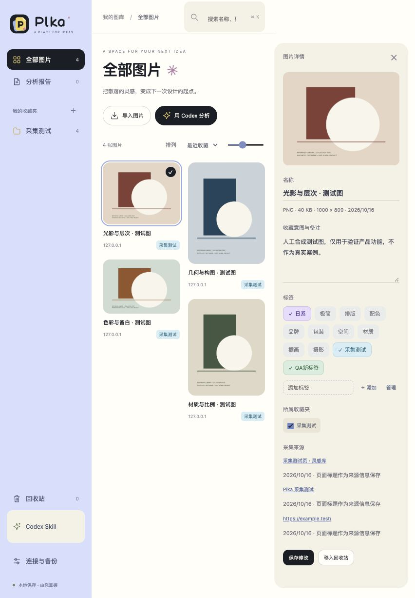
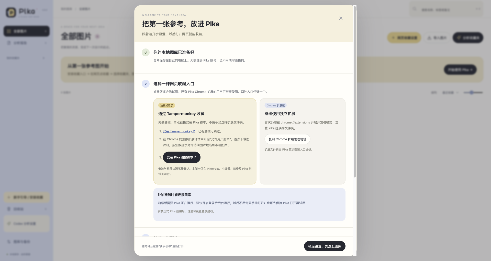

<p align="center"></p>
<h1 align="center">Plka</h1>
<p align="center">把散落的参考图片，变成下一次设计的起点。</p>
<p align="center">网页收藏 · 本地图库 · 收藏夹管理 · 自己的 Codex</p>

Plka 是为设计师制作的独立本地参考图库。浏览 Pinterest、小红书、花瓣时发起收藏，选好收藏夹和标签，回到图库整理，再让自己的 Codex 逐张分析指定收藏夹，保存有图片依据的报告。

体验以 Eagle 为参照；程序、图库和接口独立实现，不依赖 Eagle。当前版本 **v0.7.0，开发试用阶段**。



*界面样式截图使用人工合成测试图片，不包含个人收藏；当前启动方式以下文说明为准。*

## 可以做什么

- **网页收藏**：图片悬停按钮、右键单图收藏、工具栏扫描当前页图片。收藏时选择或新建收藏夹。
- **随时打开图库**：网页右侧 Plka 悬浮入口，支持拖动、临时隐藏与复用已有图库标签页。
- **按原比例浏览**：瀑布流保留图片宽高比，可调整显示密度、搜索名称、标签和备注。
- **整理参考**：多收藏夹归属、来源链接、笔记、可多选的标签；相同文件按字节查重。
- **删除与回收站**：删除收藏夹时保留其他收藏夹共享的图片，独占图片进回收站；支持恢复和单张、多选、全部永久删除。
- **Codex 分析**：安装配套 Skill，逐张读取与分析，记录进度，将综合报告写回图库。
- **本地保存与备份**：SQLite 管理索引，图片独立存储，支持完整快照和升级前自动备份。

## 第一次只需启用一次

安装包自带运行环境，不用另外安装 Node.js。请从 [版本下载页](https://github.com/yuezhihuohua/plka/releases/tag/v0.7.0) 的 **Assets（附件）** 下载对应文件；不要点绿色 Code 按钮下载源码，也不要选择 Source code。

| 电脑 | 选择的文件 | 首次入口 |
| --- | --- | --- |
| Mac，Apple 芯片（M 系列） | `Plka-Mac-arm64-v版本号.dmg` | 拖入“应用程序”后打开 Plka |
| Mac，Intel 芯片 | `Plka-Mac-x64-v版本号.dmg` | 拖入“应用程序”后打开 Plka |
| Windows，Intel / AMD 64 位 | `Plka-Windows-x64-v版本号.zip` | 双击 1-Install-Plka.cmd |

### Windows：照着这 5 步开始用

**Windows 版的图库在 Chrome 页面中打开，图片保存在电脑里。首次安装后在后台运行，不用一直留着黑色命令窗口。**收藏入口先选油猴或独立扩展中的一种即可。

1. **下载并完整解压。**在 [v0.7.0 下载页](https://github.com/yuezhihuohua/plka/releases/tag/v0.7.0) 下载 `Plka-Windows-x64-v0.7.0.zip`。右键 ZIP → **全部解压缩**，再打开解压后的文件夹；不要在压缩包内直接双击运行。
2. **只运行一次安装入口。**双击 **`1-Install-Plka.cmd`**。看到“Plka 已启用”并打开新手引导，即为安装成功；若默认打开的不是 Chrome，将 `http://127.0.0.1:47831/setup` 复制到 Chrome 地址栏。安装窗口提示完成后可以关闭。首次不要选 `1-Start.cmd`，它是备用启动入口。
3. **安装网页收藏入口。**推荐先用油猴：在引导中点“安装 Tampermonkey”，按页面提示添加到 Chrome；接着打开 `chrome://extensions` → Tampermonkey 的“详情” → 开启“允许用户脚本”；回到 Plka 引导，点 **“安装 Plka 油猴脚本”**，在油猴确认页点“安装”。已有 Tampermonkey 可跳过重复安装。安装后刷新原来的网页。
4. **让油猴每天可用。**在 Plka 引导中点 **“开启登录后后台运行”**，下次登录 Windows 后自动运行；首次安装已启动服务，无需重启电脑。之后可以关闭图库标签页和安装窗口，收藏时后台服务仍需运行。若不启用登录启动，重启电脑后需先运行一次 `1-Start.cmd`。油猴本身不能唤醒已停止的 Plka 服务。
5. **试收第一张图。**点引导中的 **“打开收藏测试页”** → 将鼠标放到图片上 → 点 **“收藏到 Plka”** → 选择或新建收藏夹 → 点“收藏”。看到成功提示后，点网页右侧 **“Plka · 打开图库”**，确认图片已经在收藏夹中。以后在小红书、Pinterest、花瓣按同样方式收图。

**如果想要右键收藏，并由 Chrome 自动唤醒图库：**改用独立扩展。完成第 1、2 步后，在 Chrome 地址栏输入 `chrome://extensions` → 开启“开发者模式” → “加载已解压的扩展程序” → 将 `%LOCALAPPDATA%\Plka\ChromeExtension` 粘贴到文件夹选择窗口的地址栏、回车，再点“选择文件夹”。加载完成后刷新网站并试收一张图。这个路径由安装器准备，不要选整个 Windows 解压包或 ZIP 文件。此方式不要求每天运行 Start，也不要求开启登录启动。

两种入口先启用一种，避免同一页面出现两套收藏按钮。需要 Codex 时，再到图库左侧 **“Codex 分析设置”**（Codex Skill）→ **“安装到本机 Codex”**；暂时只收图可以跳过。更多操作、文件用途与排错见 [Windows 完整使用说明](distribution/Windows-使用说明.md)。

### Mac：首次设置

1. 打开 DMG，将 Plka.app 拖入“应用程序”并打开。全新图库自动显示新手引导，已有用户可点击左侧“新手引导 / 安装收藏”。
2. 网页收藏任选一种：**油猴试用版**在引导中安装 Tampermonkey、允许用户脚本，再点“安装 Plka 油猴脚本”；**Chrome 扩展版**使用引导中的扩展文件夹，在 Chrome 开发者模式加载。
3. 油猴版：保持 Plka 运行，或在引导中自愿开启“登录后后台运行”。不需要连接码；它不会通过当前 Chrome 扩展的本机通道自动唤醒已经完全退出的应用。Chrome 扩展版仍可自动唤醒。
4. 点击“打开收藏测试页”，悬停图片收藏。选择或新建收藏夹、标签，确认后图片保存到本机；油猴下载时请保留原网页。
5. AI 为可选功能：左侧“Codex 分析设置”安装一次 Skill；“分析收藏夹”准备指令，到自己的本机 Codex 粘贴并发送，报告回到图库。

单张收藏：悬停图片 → 点“收藏到 Plka” → 在当前网页的小弹层里选择收藏夹并点“收藏”。不会打开新标签页；成功后约 1.4 秒自动收起，并记住上次成功使用的收藏夹。标签和备注可按需展开。“收集本页”也在当前页面选择图片和收藏夹；连接超过 8 秒会提示重试，关闭或按 Escape 可取消。

油猴版暂支持图片悬停、打开浏览器图库，以及“收集本页”（最多 30 张已加载图片）；Chrome 原生右键菜单由独立扩展提供，油猴版使用网页按钮或油猴菜单。两种入口可共用同一图库。

旧版 v0.3.x 升级到 v0.7.0，需要这一次替换旧扩展为新版固定身份扩展。图库保存在本机，移除旧扩展不会删除图片；旧扩展显示偏好可能重置。后续沿用同一身份与目录更新。



详细操作：[Mac 使用说明](distribution/Mac-使用说明.md) · [Windows 使用说明](distribution/Windows-使用说明.md)。Mac 应用尚未 Apple 开发者签名和公证，首次系统提示处理方法见说明。

Mac 桌面版要求 macOS 13 或更新版本，有独立窗口、程序坞图标和原生菜单。关闭窗口后转入菜单栏后台运行，Chrome 收藏继续可用；菜单栏“退出 Plka”用于结束程序。

## 日常怎么用

**收图：**在支持的网站将鼠标放到图片上，点击“＋ 收藏到 Plka”。油猴版直接在原网页选择收藏夹并保存，标签和备注按需展开，成功后约 1.4 秒自动收起；也记住上次成功使用的收藏夹。独立 Chrome 扩展另支持右键图片收藏，其采集窗口成功后约 1.8 秒关闭。部分失败时保留已成功项，并可重试未保存的图片。

**打开图库：**点击网页右侧“Plka · 打开图库”，或扩展顶部“打开 Plka 图库”。Mac 已安装桌面版时优先打开 Plka 独立窗口；服务未运行时会自动唤醒；助手尚未安装时才显示一次启用引导。其他普通网页可在扩展中选择“所有网页显示入口”，并按 Chrome 提示授予访问权限。

**分析收藏夹：**在自己的本机 Codex 中发送：

```text
$reference-library 分析“包装设计”收藏夹，逐张查看图片，比较构图、配色、字体和材质，归纳可借鉴的方向，并把报告保存回 Plka。
```

图库中的“分析收藏夹”会准备并复制指令，粘贴到自己的 Codex 发送后执行。Skill 的调用名保留 `$reference-library`。不需要给图库填写模型 API Key，也无需手工配置 MCP；`mcp.mjs` 仍保留为可选接入方式。

收藏、浏览和备份使用本机服务。Codex 分析使用自己的账号、网络和额度，所选图片及备注会交给当前模型处理。无法访问这台电脑文件的云端环境不能直接使用此本地 Skill。

## 数据放在哪里，更新会丢吗

全新安装默认路径：

| 系统 | 图库目录 |
| --- | --- |
| Mac | `~/Library/Application Support/Plka/library` |
| Windows | `%LOCALAPPDATA%\Plka\library` |
| Linux 源码运行 | `$XDG_DATA_HOME/Plka/library` 或 `~/.local/share/Plka/library` |

实际路径以“图库与备份”显示为准。已有旧版可能继续使用原程序中的 `data`，程序不会自动搬移图片；**确认实际路径、创建备份后，才能决定是否删除旧程序目录**。

```text
图库目录/
├── library.sqlite       收藏夹、图片索引、标签、备注、来源、分析状态
├── assets/              按内容哈希命名的图片文件
├── reports/             完成的分析报告
├── backups/             完整备份和升级前快照
└── .connection-key      本机连接凭据，不要上传或分享
```

手动更新：**先备份 → 启用新版助手 → 保留原图库 → 重新加载原目录扩展 → 按需更新 Skill**。完整步骤见 [手动更新与发布](docs/MAINTENANCE.md)。

删除收藏夹只将无其他收藏夹归属的图片送入回收站；永久删除不会同步删除独立备份。完整备份包含连接凭据，恢复后可继续识别；早期不含凭据的备份由助手重新自动识别，不需要手填连接码。

## 从源码运行

开发需要 **Node.js 22.12 或更新的受支持版本**；当前以 Node 22 验证，无第三方 npm 运行依赖。

```sh
npm start
```

打开 `http://127.0.0.1:47831/`。上述开发入口在前台运行。要从源码启用当前用户的自动唤醒助手（路径保持在当前工作副本）：

```sh
node tools/install-local.mjs --source
```

随后在 Chrome 加载安装器打开的 ChromeExtension 目录。源码工作副本移动后需重新启用。打包使用的首次入口会复制到用户目录，普通用户不必保留解压包作为运行位置；旧版 data 仍在原包内的用户应保留该数据目录。

```sh
node tools/install-skill.mjs
node tools/stop-service.mjs
```

停止服务仅用于维护；插件下次使用会再次唤醒。完全停用时先禁用 Chrome 中的 Plka，再停止服务。

可选环境变量：

| 变量 | 用途 |
| --- | --- |
| `REFERENCE_DATA_DIR` | 显式指定图库目录，优先于已保存的路径记录 |
| `REFERENCE_PORT` | 本地服务端口，默认 47831 |
| `PIKA_CONFIG_DIR` | 覆盖配置及启动日志目录，适合隔离测试；名称为兼容现有版本保留 |
| `CODEX_HOME` | 覆盖 Codex 目录，Skill 默认安装到其 `skills/reference-library` |

Chrome 扩展当前固定访问本机 47831 端口；更换服务端口时需同步修改扩展设置代码与权限范围，普通使用者建议保留默认值。

## 项目结构与维护

```text
extension/       Chrome Manifest V3 扩展、采集窗口、悬浮入口、品牌图形
public/          图库界面与人工测试页面
lib/             数据存储、路径绑定、升级备份
server.mjs       本地 HTTP 服务
launcher.mjs     前台启动器
skills/          可安装的 Codex Skill
tools/           Skill 安装、后台启动、打包与维护脚本
test/            数据、接口、权限、扩展行为、Skill、MCP 回归测试
distribution/    Mac / Windows 用户说明及离线 HTML
docs/            开发与手动发布说明、测试截图
.github/         自动检查、问题与变更模板
```

- [维护、构建、手动发版和回退](docs/MAINTENANCE.md)
- [产品目标与功能边界](PRODUCT.md)
- [当前验证范围](VALIDATION.md)
- [版本记录](CHANGELOG.md)
- [报告问题与提交修改](CONTRIBUTING.md)

运行自动检查：

```sh
npm run check
npm test
```

打包由维护者手动执行，便携包与校验值放到 GitHub Releases，源码仓库不提交 `release/`、图片库、数据库、运行环境、日志或本机配置。

## 当前边界

只采集页面已加载的图片，不承诺原始高清分辨率；受登录、页面结构、防盗链和网站更新影响。扫描上限 300 张，单张导入上限 16 MB。Pinterest 的 `ph.pinterest.com` 页面已有验证记录，小红书、花瓣仍需结合实际页面持续验收。浏览器设置页和扩展商店等受限制页面不能注入悬浮按钮。

当前不提供云同步、账户协作、自动更新、相似图检索、商店安装或成熟大图库性能保证。配套 Skill 已验证读图与报告回写接口；真实视觉结论由使用者自己的 Codex 执行并审阅。

目前尚未选定项目开源许可证；公开仓库供查看、下载与试用，不代表已授予开源许可证。内置第三方运行环境的许可证随安装包提供。

## 自动启动怎样保护图片

默认使用一个本机图库。安装器通过 Chrome Native Messaging 注册本机助手，只允许固定身份的 Plka 扩展请求启动并获取内部凭据；内容脚本和普通网站拿不到凭据。扩展身份固定后，更新不再依赖安装文件夹生成的新 ID。

连接凭据仍由系统内部保存和校验，用于拒绝其他网页读取私有接口；界面不再要求使用者管理它。Chrome 启动时唤醒助手，后台意外停止后可由收藏或打开图库动作恢复，不额外要求登录电脑自动运行。
